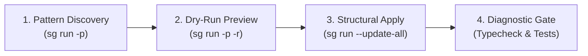

# AST-Refactor: Structural AST Pattern Refactoring

Gemini 4 Argon의 코드 구문 구조(AST) 이해력과 `sg` (`ast-grep` CLI)를 결합하여, 단순 텍스트 정규식 치환의 한계를 극복하고 안전한 대규모 구문 단위 리팩토링을 수행합니다.

## Antigravity Tool Mapping

| 작업 단계 | 실행 도구 / API |
| --- | --- |
| **AST 패턴 탐색** | `run_command` → `sg run -p '<pattern>' -l <lang> <paths>` |
| **변경 시뮬레이션 (Dry-Run)** | `run_command` → `sg run -p '<pattern>' -r '<rewrite>' -l <lang> <paths>` |
| **원자적 AST 치환** | `run_command` → `sg run -p '<pattern>' -r '<rewrite>' -l <lang> --update-all <paths>` |
| **단일/소규모 정밀 편집** | `replace_file_content` |
| **타입 무결성 진단** | `run_command` → 프로젝트 타입체커 (`tsc --noEmit`, `basedpyright`, `cargo check`, `go vet ./...`) |
| **병렬 영향도 분석** | `invoke_subagent` (`Model: "inherit"`, `toolAction`, `toolSummary`) |

---

## 4-Step Structural Refactoring Workflow



### Step 1: Pattern Discovery (AST 검색)
정규식 대신 언어별 AST 메타변수(`$VAR`, `$$$ARGS`)를 사용하여 리팩토링 대상 패턴을 탐색합니다.

```bash
# 예시: TypeScript Promise.then() 체이닝 탐색
sg run -p '$PROMISE.then(($RES) => { $$$BODY })' -l ts src/
```

### Step 2: Dry-Run & Diff Preview (사전 시뮬레이션)
`--update-all` 플래그 없이 실행하여 실제 파일 변경 전에 치환될 AST 노드와 diff를 검증합니다.

```bash
sg run -p '$PROMISE.then(($RES) => { $$$BODY })' -r 'const $RES = await $PROMISE; $$$BODY' -l ts src/
```

### Step 3: Atomic Structural Replacement (원자적 치환)
Dry-run diff 결과를 검증한 후 `--update-all`로 파일에 직접 반영합니다.

```bash
sg run -p '$PROMISE.then(($RES) => { $$$BODY })' -r 'const $RES = await $PROMISE; $$$BODY' -l ts --update-all src/
```

### Step 4: Diagnostic Gate (타입체커 & 테스트 무결성 검증)
구조 치환 후 타입 에러나 린트 결함이 발생하지 않았는지 즉시 검증합니다.

```bash
tsc --noEmit && bun test
```

---

## Subagent Dispatch Pattern

대규모 레포지토리에서 모듈별 리팩토링 영향도를 병렬 분석할 때는 Antigravity 표준 스키마(기본 3~4개 레인 이하)를 사용합니다.

```javascript
invoke_subagent({
  Subagents: [
    {
      TypeName: "self",
      Role: "AST Pattern Analyzer",
      Model: "inherit",
      Prompt: `TASK: Analyze AST refactoring candidates for target pattern in scope.
DELIVERABLE: matched AST nodes, potential edge-cases, and variable scope conflicts.
SCOPE: repository read-only
VERIFY: parent verifies dry-run diff against cited files.`
    }
  ],
  toolAction: "Analyzing AST refactoring patterns",
  toolSummary: "AST pattern analysis"
})
```
