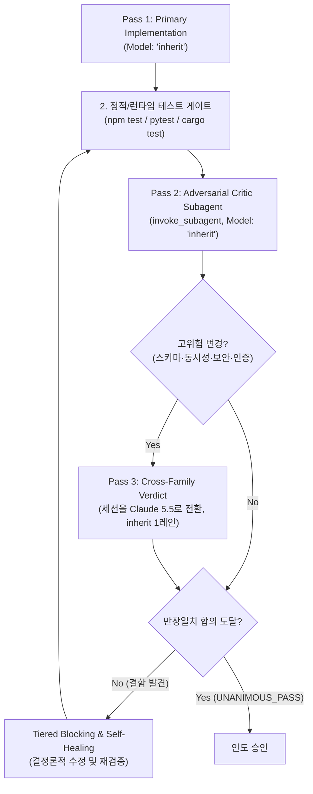

# Dual-Verify: 2-Pass Real-Time Co-Verification

코드 구현 직후 1차 구현 결과물을 바탕으로, 독립된 적대적 감사 서브에이전트가 3대 핵심 영역(① 보안/인젝션, ② 동시성/비동기 레이스, ③ 경계 계약/타입 안전성)을 집중 감사하여 만장일치(Unanimous Pass) 합의에 도달했을 때만 완료를 승인하는 2-Pass 품질 보증 프로토콜이다. 고위험 변경에는 **Pass 3(교차 가족 판정)**이 기본으로 붙는다.



---

## 2-Pass Verification Protocol

### Pass 1: Primary Implementation (`Model: "inherit"`)
핵심 비즈니스 로직과 단위 테스트를 작성하고 기본 테스트 스위트를 통과시킨다. 100줄 이하 청크로 쓰고, 쓴 파일은 다시 연다.

### Pass 2: Adversarial Critic (`invoke_subagent`, `Model: "inherit"`)
독립된 서브에이전트가 코드의 잠재적 취약점을 공격적으로 감사한다. 감사 결과의 모든 항목은 `파일:라인`과 함께 돌아와야 하며, 근거 라인을 열어 보지 않은 판정은 무효다(코드베이스 "설명" 환각 방지).

```
invoke_subagent(
  Subagents=[
    {
      TypeName: "self",
      Role: "Adversarial Code Critic",
      Model: "inherit",
      Prompt: """목표: 변경된 코드에 대한 3대 영역 적대적 감사를 수행하라.
완료 조건: 아래 3대 영역의 결함 유무를 파일:라인 근거와 함께 판정(UNANIMOUS_PASS 또는 BLOCKING)하라. 근거 라인은 반드시 직접 열어 인용한다.
범위:
1. Security: SQLi, command injection, path traversal, untrusted inputs.
2. Concurrency: unawaited promises, race conditions, lock deadlocks.
3. Boundary: exhaustive matches, no 'as any', null safety.
종료 조건: 같은 도구 호출 3회 반복 / 도구 호출 40회 초과 → UNKNOWN 반환
반환 형식: ≤40줄, 판정·근거·재현 명령만"""
    }
  ],
  toolAction: "Running adversarial code review",
  toolSummary: "Adversarial 3-domain code review"
)
```

### Pass 3: Cross-Family Verdict (고위험 변경 기본)

적용 조건(하나라도 해당): DB 스키마·마이그레이션, 동시성 원시 연산, 인증·인가·암호, 결제·정산, 공용 API 계약 변경.

근거: Gemini 4 Argon은 터미널·에이전틱 코딩 벤치(Terminal-Bench 4.0, FrontierSWE v2)에서 Claude Opus 5.5에 뒤지고, 기존 코드베이스 리팩터링 과제에서 사람 검토 기각률이 높다. 같은 가족의 두 번째 의견은 같은 사각지대를 공유한다.

절차:
1. Pass 2 결과와 `git diff`를 `.lazyargon/dual-verify-handoff.md`에 ≤80줄로 적는다(판정 대상 파일 목록, 테스트 명령, Pass 2 지적 사항).
2. 사용자에게 **세션 모델을 Claude Sonnet/Opus 5.5로 전환**해 달라고 한 번 요청한다. 전환이 불가능하면(Pro 플랜, 할당량 소진) 그 사실을 보고에 적고 Pass 2 결과로 완료하되 `cross-family: skipped(<사유>)`를 명시한다.
3. 전환된 세션에서 `Model: "inherit"` 판정 레인 **하나만** 띄운다(Claude 할당량이 희소하다). 프롬프트는 핸드오프 파일 경로 + "BLOCKING 항목만 파일:라인으로 반환, ≤30줄".
4. 판정이 돌아오면 원래 세션으로 복귀해 Self-Healing 루프를 돈다.

### Tiered Blocking & Self-Healing Policy
- `P0 (Critical Security)`: 즉각 블로킹 및 수정 후 재검증.
- `P1 (Concurrency Hazard)`: 비동기 레이스 수정 전까지 완료 선언 금지.
- `P2 (Type/Boundary Gap)`: 타입 및 경계 조건 즉시 보강.
- `P3 (Adoption Screen)`: 스테일 데이터 가정·비공개 내부 API 의존·범위 밖 수정·요청 대비 과대 변경은 테스트 통과와 무관하게 기각한다.
- `P4 (Blind Comparison & KEEP_BASE — harness2)`: 두 후보 구현이나 리팩토링 전후를 비교할 때는 "수정본/고도화본"이라는 라벨에 가산점을 주지 않고(익명 비교), 실행된 렌더링/출력 증거와 요청사항 대조만으로 판정한다. 변경이 관찰 가능한 개선을 입증하지 못하면 원본(`KEEP_BASE`)을 채택한다.
