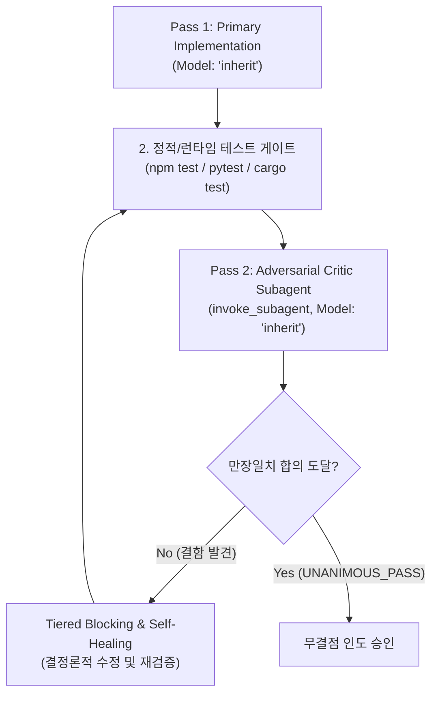

# Dual-Verify: 2-Pass Real-Time Co-Verification

코드 구현 직후 `Model: "inherit"` 워커의 1차 구현 결과물을 바탕으로, 독립된 `Model: "inherit"` 적대적 감사 서브에이전트가 3대 핵심 영역(① 보안/인젝션, ② 동시성/비동기 레이스, ③ 경계 계약/타입 안전성)을 집중 감사하여 만장일치(Unanimous Pass) 합의에 도달했을 때만 완료를 승인하는 2-Pass 품질 보증 프로토콜입니다.



---

## 2-Pass Verification Protocol

### Pass 1: Primary Implementation (`Model: "inherit"`)
핵심 비즈니스 로직과 단위 테스트를 작성하고 기본 테스트 스위트를 통과시킵니다.

### Pass 2: Adversarial Critic (`invoke_subagent`, `Model: "inherit"`)
독립된 서브에이전트가 코드의 잠재적 취약점을 공격적으로 감사합니다 (`Model: "inherit"`).

```
invoke_subagent(
  Subagents=[
    {
      TypeName: "self",
      Role: "Adversarial Code Critic",
      Model: "inherit",
      Prompt: """목표: 변경된 코드에 대한 3대 영역 적대적 감사를 수행하라.
완료 조건: 아래 3대 영역의 결함 유무를 파일:라인 근거와 함께 판정(UNANIMOUS_PASS 또는 BLOCKING)하라.
범위:
1. Security: SQLi, command injection, path traversal, untrusted inputs.
2. Concurrency: unawaited promises, race conditions, lock deadlocks.
3. Boundary: exhaustive matches, no 'as any', null safety."""
    }
  ],
  toolAction: "Running adversarial code review",
  toolSummary: "Adversarial 3-domain code review"
)
```

### Tiered Blocking & Self-Healing Policy
- `P0 (Critical Security)`: 즉각 블로킹 및 수정 후 재검증.
- `P1 (Concurrency Hazard)`: 비동기 레이스 수정 전까지 완료 선언 금지.
- `P2 (Type/Boundary Gap)`: 타입 및 경계 조건 즉시 보강.
