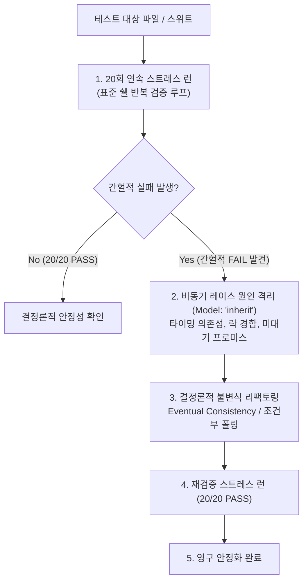

# Flaky-Guard: Self-Healing Non-Deterministic Test Hardener

표준 쉘 반복 실행 루프와 `invoke_subagent` (`Model: "inherit"`)를 활용하여 테스트 스위트를 20회 연속 스트레스 실행하고, 비동기 타이밍 의존성(`setTimeout`, microtask 미대기, 포트 경합)으로 인해 간헐적으로 실패하는 Flaky Test를 포착하여 결정론적(Deterministic) 구조로 하드닝하는 프로토콜입니다.



---

## 4-Step Flaky-Guard Workflow

### Step 1: Repeat Stress Loop (20회 반복 스트레스 런)
표준 쉘 반복 명령으로 동일 테스트를 연속 실행하여 간헐적 실패를 재현하고 실패 로그를 수집합니다.

```powershell
# Windows PowerShell: 20회 연속 스트레스 실행 (실패 즉시 중단)
1..20 | ForEach-Object {
  Write-Host "=== Run $_/20 ==="
  npm test
  if ($LASTEXITCODE -ne 0) { throw "FAILED on iteration $_" }
}
```

```bash
# POSIX (bash/zsh): 20회 연속 스트레스 실행 (실패 즉시 중단 및 로그 확인)
for i in $(seq 1 20); do
  echo "=== Run $i/20 ==="
  npm test || { echo "FAILED on iteration $i"; exit 1; }
done
```

### Step 2: Flakiness Root-Cause Isolation (`Model: "inherit"`)
`invoke_subagent` (`Model: "inherit"`)를 사용하여 실패 로그와 타이밍 트레이스를 분석합니다.

```
invoke_subagent(
  Subagents=[
    {
      TypeName: "self",
      Role: "Flaky Test Diagnostician",
      Model: "inherit",
      Prompt: """목표: 간헐적 테스트 실패 로그를 분석하고 비동기 레이스 원인을 격리하라.
완료 조건: 아래 체크리스트 기준 원인 지목 및 결정론적 수정 코드 제시.
범위:
1. Arbitrary sleep/delay (setTimeout / time.sleep) vs deterministic event listeners
2. Shared global state / uncleaned DB records across test cases
3. Unawaited microtasks / floating Promises
4. Port / filesystem resource contention"""
    }
  ],
  toolAction: "Diagnosing flaky test timing hazards",
  toolSummary: "Flaky test diagnosis"
)
```

### Step 3: Deterministic Hardening (결정론적 리팩토링)
임의의 시간 지연(`setTimeout(100)`)을 조건부 폴링 또는 이벤트 완료 대기(Eventual Invariant)로 수정합니다.

### Step 4: Verification Stress Gate (재검증 20회 패스)
수정 후 20회 연속 실행에서 단 1건의 실패도 없음(`20/20 PASS`)을 확인하고 완료합니다.
