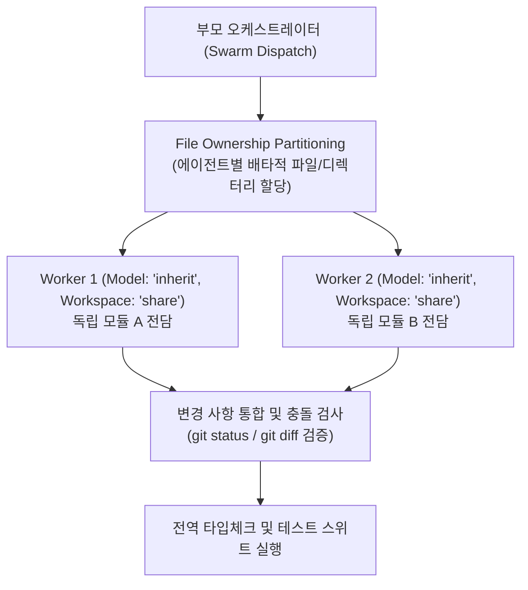

# Swarm-Sync: Partitioned Swarm Synchronization & Workspace Isolation

다수의 병렬 서브에이전트가 동시에 실행될 때 동일한 파일에 동시 쓰기를 시도하여 발생하는 파일 손상 및 충돌을 원천 차단하기 위해, 서브에이전트별 배타적 파일 소유권(File Ownership Partitioning) 또는 `invoke_subagent`의 `Workspace: "share"` 격리 모드를 사용하는 오케스트레이션 프로토콜입니다.



---

## 4-Step Swarm-Sync Workflow

### Step 1: File Ownership Partitioning (파일 소유권 분할)
서브에이전트 디스패치 전, 각 워커가 수정할 수 있는 파일/디렉터리 경계를 겹치지 않게 분할합니다.

### Step 2: 병렬 서브에이전트 실행 (`Model: "inherit"`, `Workspace: "share"`)
독립된 워크스페이스 공유 모드(`Workspace: "share"`) 또는 명확히 분리된 `범위`를 지정하여 서브에이전트를 단일 `invoke_subagent` 호출로 병렬 실행합니다.

```
invoke_subagent(
  Subagents=[
    {
      TypeName: "self",
      Role: "Auth Module Worker",
      Model: "inherit",
      Workspace: "share",
      Prompt: "목표: 인증 토큰 검증 모듈을 구현하라.\n완료 조건: 단위 테스트 통과.\n범위: src/auth/ 내부 파일만 수정."
    },
    {
      TypeName: "self",
      Role: "Billing Module Worker",
      Model: "inherit",
      Workspace: "share",
      Prompt: "목표: 과금 정산 모듈을 구현하라.\n완료 조건: 단위 테스트 통과.\n범위: src/billing/ 내부 파일만 수정."
    }
  ],
  toolAction: "Running isolated swarm workers",
  toolSummary: "Parallel swarm worker execution"
)
```

### Step 3: 변경 사항 통합 및 교차 검증
각 워커 완료 후 변경된 파일 목록(`git status`, `git diff --stat`)이 지정된 소유권 경계를 침범하지 않았는지 확인합니다.

### Step 4: 전역 타입체크 및 통합 테스트 검증
프로젝트 전체 타입체크(`tsc --noEmit`, `basedpyright`, `cargo check`) 및 통합 테스트 스위트를 실행하여 회귀가 없음을 실측 검증합니다.
