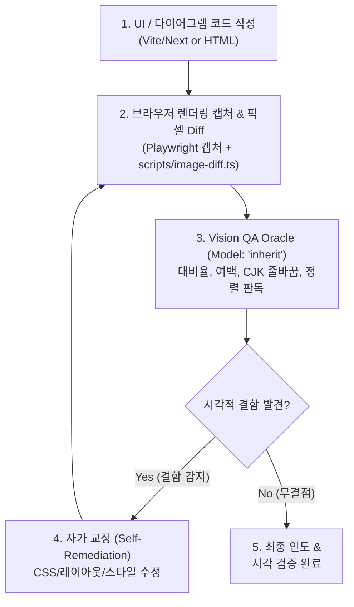

# UI-Loopback: Real-time Visual Inspection & Self-Remediation

브라우저/Playwright 스크린샷 캡처, `skills/visual-qa/scripts/image-diff.ts`(`scripts/cli.ts`), 그리고 Gemini 4 Argon(`Model: "inherit"`)의 멀티모달 비전 판독을 결합하여 코드 변경 직후 렌더링 화면을 검사하고 시각적 결함(여백 불균형, CJK 글리프 잘림, 대비율 미달, SVG/Mermaid 다이어그램 정렬)을 자가 교정하는 피드백 루프입니다.



---

## 4-Step UI-Loopback Workflow

### Step 1: Render, Capture & Pixel Diff (실시간 렌더링 캡처 및 비교)
Playwright 또는 브라우저 도구로 실제 렌더링 화면을 캡처하고, 참조 이미지가 있을 경우 `scripts/cli.ts`(`scripts/image-diff.ts`)로 객관적 픽셀 차이를 계측합니다:

```bash
# 참조 이미지와 실제 렌더링 캡처본의 픽셀 비교 및 핫스팟 분석
npx -y tsx skills/visual-qa/scripts/cli.ts image-diff <reference.png> <actual.png>
```

인터랙션(클릭/입력/상태 전이)이 필요한 케이스에는 Playwright 브라우저 도구를 사용하여 지정된 뷰포트에서 실제 페이지를 조작하고 캡처합니다:

```
# Web UI: Playwright / 브라우저 캡처 워크플로우
browser_navigate  → dev 서버 URL (예: http://localhost:5173)
browser_resize    → 참조와 동일한 뷰포트 (예: 1440x900)
browser_snapshot  → 접근성 트리 획득 (셀렉터 대신 element ref 사용)
browser_click / browser_type / browser_wait_for → 필요한 상태(호버, 오픈 메뉴)에 도달
browser_take_screenshot → PNG 저장
browser_close     → QA 브라우저 컨텍스트 종료 (청소 필수)
```

### Step 2: Vision Inspection Oracle (`Model: "inherit"`)
`invoke_subagent` (`Model: "inherit"`)를 사용하여 캡처된 스크린샷의 시각적 완성도를 판독합니다.

```
invoke_subagent(
  Subagents=[
    {
      TypeName: "self",
      Role: "Visual QA Oracle",
      Model: "inherit",
      Prompt: """REVIEW TYPE: VISUAL INSPECTION & CJK FIDELITY (Multimodal)
GOAL: Inspect the rendered UI screenshot for visual bugs, alignment issues, and contrast defects.

CHECKLIST:
1. **Layout & Spacing**: Unbalanced padding/margin, horizontal overflow, flex/grid breakage.
2. **CJK & Typography**: Korean/CJK glyph clipping, unnatural line breaks, baseline drops.
3. **Color & Contrast**: WCAG AA color contrast ratios, dark mode readability.
4. **Diagram Precision**: SVG clipping, Mermaid node text overlap, arrow misalignments.
5. **3D & WebGL Canvas**: Canvas mounting integrity, WebGL context loss, alpha transparency blending, viewport resize response.

OUTPUT FORMAT:
VERDICT: PERFECT | REMEDIATION_REQUIRED
DEFECTS: list of specific visual flaws with location and severity
CSS_FIX: concrete CSS/code adjustments required"""
    }
  ],
  toolAction: "Inspecting rendered UI via native vision",
  toolSummary: "Visual UI loopback inspection"
)
```

### Step 3: Self-Remediation Loop (자가 교정)
`REMEDIATION_REQUIRED` 판정 시 제안된 CSS 및 마크업을 즉시 반영하고 재렌더링하여 재검증합니다. (최대 3회 반복)

### Step 4: Quality Delivery (품질 보증 인도)
`PERFECT` 판정을 획득한 후 최종 코드를 사용자에게 인도합니다.
